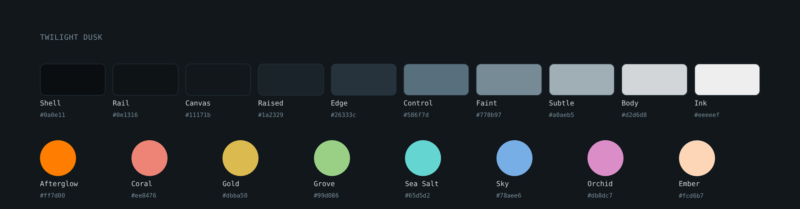

<h1 align="center">Twilight</h1>

<p align="center"><i>Calm by design, legible by proof.</i></p>

<p align="center">
  <a href="#flavors">Flavors</a> ·
  <a href="#accents">Accents</a> ·
  <a href="#palette">Palette</a> ·
  <a href="docs/design-system.md">Design system</a> ·
  <a href="docs/construction.md">Construction</a>
</p>

<p align="center">
  <picture>
    <source media="(prefers-color-scheme: dark)" srcset="assets/palette-dusk.png">
    <source media="(prefers-color-scheme: light)" srcset="assets/palette-dawn.png">
    
  </picture>
</p>

<p align="center">
  <a href="https://www.w3.org/TR/WCAG21/#contrast-enhanced"></a>
  
  
</p>

<br>

Twilight is a color theme specification: two flavors, ten neutrals, eight colors and the rules that connect them. None of the palette colors were picked by eye. One value was chosen as a seed; every color was calculated from it, and every pairing was checked for contrast and for color-vision deficiency.

## Why

I used Dracula for years. In almost every port the accent was pink/purple, and it's not exactly my favorite color. Catppuccin and its peach accent came closer, and it was the one I used until now, but my workspace still did not feel like mine.

I wanted my own theme but I do not trust my eye for color. So instead of choosing colors, I set out to derive them: start from one value, apply rules from color science and accessibility, and keep only what can be measured.

## Principles

- **Calculated.** One seed, everything else derived. Each value can be traced back to a rule in [construction.md](docs/construction.md).
- **Legible everywhere.** Each text level is solved against the hardest surface it can appear on, so its contrast holds on all of them.
- **Distinct for everyone.** Code colors were optimized together so they stay apart under deuteranopia, protanopia and tritanopia.
- **Calm.** Surfaces are quiet, the accent is a detail rather than a field, and nothing is pure black or pure white.

## Flavors

|                                                                                           | Flavor   | Character                                                                                   |
|-------------------------------------------------------------------------------------------|----------|---------------------------------------------------------------------------------------------|
|  | **Dusk** | Dark. Code colors at 7:1 or higher (WCAG AAA).                                              |
|  | **Dawn** | Light. The light end of the same system; code colors at 4.5:1 or higher (WCAG AA).          |

Both flavors share every role, every rule and one neutral curve. Dawn's Canvas is Dusk's Ink, and Dawn's Ink is Dusk's Canvas.

## Accents

Any of the eight colors can be the accent. The accent marks focus, the cursor, active items, badges, links and the main action; it never colors content. Code colors and background states stay the same whichever accent you pick.

A theme is named by flavor and accent: **Twilight Dusk Grove**, **Twilight Dawn Sky**. Afterglow is the default, so **Twilight Dusk** means Twilight Dusk Afterglow.

| Accent    | Dusk                                                                                                | Dawn                                                                                                | Example name            |
|-----------|-----------------------------------------------------------------------------------------------------|-----------------------------------------------------------------------------------------------------|-------------------------|
| Afterglow |  `#ff7d00` |  `#ff7d00` | Twilight Dusk Afterglow |
| Coral     |  `#ee8476` |  `#8d3826` | Twilight Dusk Coral     |
| Gold      |  `#dbba50` |  `#766014` | Twilight Dusk Gold      |
| Grove     |  `#99d086` |  `#39713a` | Twilight Dusk Grove     |
| Sea Salt  |  `#65d5d2` |  `#176a7e` | Twilight Dusk Sea Salt  |
| Sky       |  `#78aee6` |  `#3f4880` | Twilight Dusk Sky       |
| Orchid    |  `#db8dc7` |  `#813b67` | Twilight Dusk Orchid    |
| Ember     |  `#fcd6b7` |  `#67320a` | Twilight Dusk Ember     |

Each accent comes with derived variants for text, pressed and focus states, all solved to the same contrast rules. See [Accents in the design system](docs/design-system.md#5-accents).

## Palette

<details open>
<summary><b>Dusk</b></summary>
<br>

&nbsp;&nbsp;

**Neutrals**

| | Name | Hex | RGB | OKLCH | Role |
|:-:|---|---|---|---|---|
|  | Shell | `#0a0e11` | `rgb(10, 14, 17)` | `oklch(16.1% 0.009 240.6)` | Outer frame |
|  | Rail | `#0e1316` | `rgb(14, 19, 22)` | `oklch(18.3% 0.010 234.4)` | Docked panels |
|  | Canvas | `#11171b` | `rgb(17, 23, 27)` | `oklch(20.0% 0.012 237.4)` | Content |
|  | Raised | `#1a2329` | `rgb(26, 35, 41)` | `oklch(25.0% 0.017 237.6)` | Floating layers |
|  | Edge | `#26333c` | `rgb(38, 51, 60)` | `oklch(31.3% 0.024 238.7)` | Dividers |
|  | Control | `#586f7d` | `rgb(88, 111, 125)` | `oklch(52.8% 0.035 235.0)` | Control boundaries |
|  | Faint | `#778b97` | `rgb(119, 139, 151)` | `oklch(62.5% 0.029 234.3)` | Tertiary text |
|  | Subtle | `#a0aeb5` | `rgb(160, 174, 181)` | `oklch(74.2% 0.019 229.1)` | Secondary text, icons |
|  | Body | `#d2d6d8` | `rgb(210, 214, 216)` | `oklch(87.4% 0.005 228.8)` | Default text |
|  | Ink | `#eeeeef` | `rgb(238, 238, 239)` | `oklch(94.9% 0.001 0)` | Titles, focus |

**Colors**

| | Name | Hex | RGB | OKLCH | Meaning |
|:-:|---|---|---|---|---|
|  | Afterglow | `#ff7d00` | `rgb(255, 125, 0)` | `oklch(72.7% 0.188 51.7)` | Default accent |
|  | Coral | `#ee8476` | `rgb(238, 132, 118)` | `oklch(72.6% 0.132 28.6)` | Error, removed |
|  | Gold | `#dbba50` | `rgb(219, 186, 80)` | `oklch(79.8% 0.129 91.9)` | Warning, modified |
|  | Grove | `#99d086` | `rgb(153, 208, 134)` | `oklch(80.1% 0.116 137.9)` | Success, added |
|  | Sea Salt | `#65d5d2` | `rgb(101, 213, 210)` | `oklch(80.7% 0.102 193.0)` | Renamed, auxiliary |
|  | Sky | `#78aee6` | `rgb(120, 174, 230)` | `oklch(73.5% 0.100 250.2)` | Information |
|  | Orchid | `#db8dc7` | `rgb(219, 141, 199)` | `oklch(74.1% 0.120 336.7)` | Conflict |
|  | Ember | `#fcd6b7` | `rgb(252, 214, 183)` | `oklch(90.0% 0.059 61.2)` | Parameters |

</details>

<details>
<summary><b>Dawn</b></summary>
<br>

&nbsp;&nbsp;

**Neutrals**

| | Name | Hex | RGB | OKLCH | Role |
|:-:|---|---|---|---|---|
|  | Shell | `#dfe1e3` | `rgb(223, 225, 227)` | `oklch(90.9% 0.003 247.9)` | Outer frame |
|  | Rail | `#e6e8e8` | `rgb(230, 232, 232)` | `oklch(92.9% 0.002 197.1)` | Docked panels |
|  | Canvas | `#eeeeef` | `rgb(238, 238, 239)` | `oklch(94.9% 0.001 0)` | Content |
|  | Raised | `#dbdedf` | `rgb(219, 222, 223)` | `oklch(89.9% 0.004 219.5)` | Floating layers |
|  | Edge | `#c4cace` | `rgb(196, 202, 206)` | `oklch(83.6% 0.009 236.6)` | Dividers |
|  | Control | `#6c818f` | `rgb(108, 129, 143)` | `oklch(59.1% 0.033 237.3)` | Control boundaries |
|  | Faint | `#4f6574` | `rgb(79, 101, 116)` | `oklch(49.5% 0.036 238.2)` | Tertiary text |
|  | Subtle | `#364855` | `rgb(54, 72, 85)` | `oklch(39.2% 0.032 240.0)` | Secondary text, icons |
|  | Body | `#1f2931` | `rgb(31, 41, 49)` | `oklch(27.5% 0.020 242.6)` | Default text |
|  | Ink | `#11171b` | `rgb(17, 23, 27)` | `oklch(20.0% 0.012 237.4)` | Titles, focus |

**Colors**

| | Name | Hex | RGB | OKLCH | Meaning |
|:-:|---|---|---|---|---|
|  | Afterglow | `#ff7d00` | `rgb(255, 125, 0)` | `oklch(72.7% 0.188 51.7)` | Default accent |
|  | Coral | `#8d3826` | `rgb(141, 56, 38)` | `oklch(45.5% 0.120 33.6)` | Error, removed |
|  | Gold | `#766014` | `rgb(118, 96, 20)` | `oklch(49.7% 0.094 91.5)` | Warning, modified |
|  | Grove | `#39713a` | `rgb(57, 113, 58)` | `oklch(49.6% 0.104 144.2)` | Success, added |
|  | Sea Salt | `#176a7e` | `rgb(23, 106, 126)` | `oklch(48.7% 0.081 218.5)` | Renamed, auxiliary |
|  | Sky | `#3f4880` | `rgb(63, 72, 128)` | `oklch(42.2% 0.093 274.8)` | Information |
|  | Orchid | `#813b67` | `rgb(129, 59, 103)` | `oklch(45.9% 0.111 343.8)` | Conflict |
|  | Ember | `#67320a` | `rgb(103, 50, 10)` | `oklch(38.1% 0.090 51.8)` | Parameters |

</details>

Machine-readable values for both flavors, all accents, background states and the 16 terminal colors are in [palette/twilight.json](palette/twilight.json).

## Guarantees

| | Dusk | Dawn |
|---|---|---|
| Body text on any surface | 10.9:1 | 10.9:1 |
| Faintest text on any surface | 4.5:1 | 4.5:1 |
| Code colors on every code surface | 7.0:1 | 4.5:1 |
| Control boundaries and focus | 3.0:1 | 3.0:1 |
| Smallest code-color difference, color-vision deficiency | ΔE 0.061 | ΔE 0.040 |
| Pure black or white | none | none |

Contrast is WCAG 2.x, measured on final sRGB values. The color-vision figure is the worst case across simulated deuteranopia, protanopia and tritanopia. Full tables are in the [design system](docs/design-system.md#13-guarantees).

## How it was built

All math is done in OKLCH and checked in sRGB. Afterglow is the most chromatic orange sRGB holds at the seed's hue, and the neutrals sit at the exact complement of that hue. Dusk's surface lightness follows a geometric progression; Dawn keeps the same perceptual distances at the light end of the curve. Text levels are solved by contrast target. The six terminal hues are anchored to the ANSI standard, placed at each hue's natural lightness and lit by one shared warm chroma law. Those six and Ember were then optimized together for distinctness under four vision models. Each code category has one color, and Coral and Afterglow never color code.

The full derivation, with every formula and parameter, is in [construction.md](docs/construction.md).

## Using Twilight

Twilight is defined independently of any application. To build a theme for a tool, map its regions to the surface roles and follow the checklist in [Building a theme from this definition](docs/design-system.md#12-building-a-theme-from-this-definition).

## Repository

```
.
├── README.md
├── .agents/skills/
│   └── twilight-auditor/    audit skill: floors, reproduction, consistency
├── assets/                  palette images
├── docs/
│   ├── design-system.md     roles, rules and application
│   └── construction.md      derivation, optimization and validation
├── palette/
│   └── twilight.json        all values, machine-readable
├── CONTRIBUTING.md
├── CHANGELOG.md
└── LICENSE
```

## License

[MIT](LICENSE) © José D. Gutiérrez
