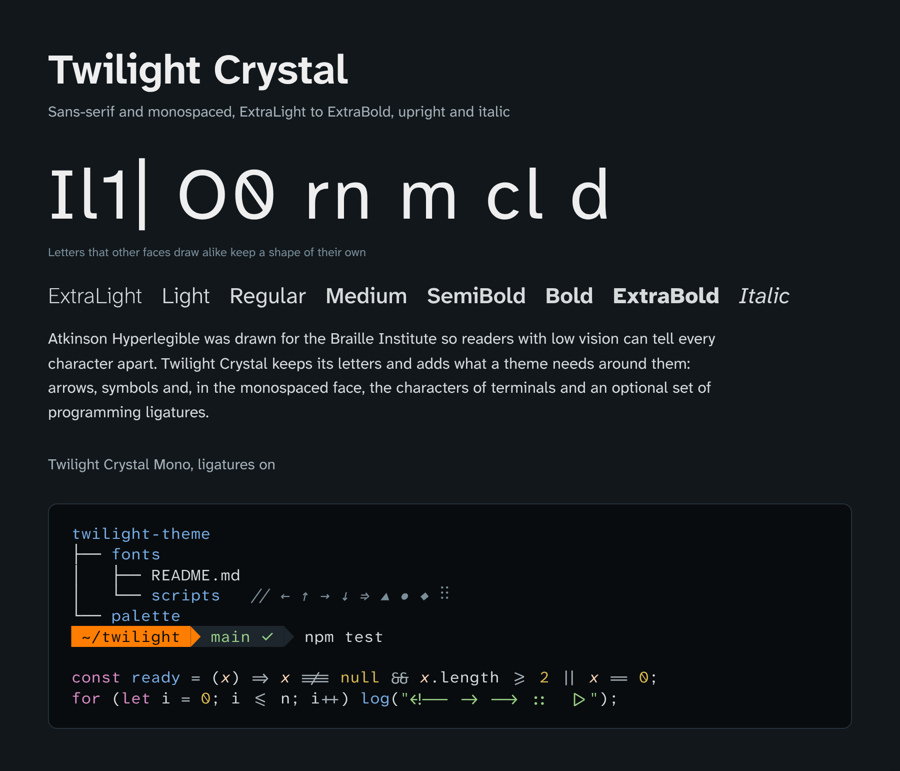

<h1 align="center">Twilight Crystal</h1>

  

  <a href="https://github.com/iamdantz/twilight-theme/releases/latest">Download</a> ·
  <a href="../docs/typography.md">Typography guide</a> ·
  <a href="OFL.txt">License</a> ·
  <a href="FONTLOG.txt">Changes and credits</a>

Twilight Crystal and Twilight Crystal Mono are the typefaces of [Twilight Theme](../README.md): a sans-serif for interfaces, documents, images and the web, and a monospaced face for code editors and terminals. They are derivatives of [Atkinson Hyperlegible Next](https://fonts.google.com/specimen/Atkinson+Hyperlegible+Next) and [Atkinson Hyperlegible Mono](https://fonts.google.com/specimen/Atkinson+Hyperlegible+Mono), designed by Applied Design Works and Letters from Sweden for the Braille Institute, and they keep those letters unchanged.

## Legibility

Atkinson Hyperlegible was drawn so that readers with low vision can tell characters apart. Pairs that other faces draw alike get shapes of their own: I has serifs and l a tail, 1 has a flag, 0 has a slash, and rn stays apart from m. Legibility is why Twilight Theme chose it.

Twilight Crystal keeps that design: every letter, number and punctuation mark keeps the outline, spacing and kerning of the original, and every build checks this against the originals: same glyphs within 0.5 font units, same shaping. The static fonts are hinted as the originals are, and a check confirms on every build that alignment and sharpness from 9 to 20 pixels, and the distinction of those pairs from 9 to 14 pixels, are no worse than the originals'.

## Made for terminals

Twilight Crystal Mono draws the characters terminal programs build their screens with, in the same strokes as its letters:

- **Box drawing and block elements**, all 160 of U+2500–259F. Lines reach the edges of the cell, so they join with the next cell and the next row without gaps, in trees, tables and full-screen programs.
- **Powerline separators**, filled, outlined and rounded, for prompts and status lines.
- **Braille patterns**, all 256, on the grid of the cell, for the graphs of terminal monitors.

In the static fonts these characters carry their own hinting: their lines land on whole pixel rows, at least one pixel thick, and no ink falls outside the cell, at 9 to 24 pixels.

## Optional ligatures

Twilight Crystal Mono includes Fira Code's programming ligatures, off by default in stylistic set 1. Turned on, `->`, `!==`, `<=`, `&&`, `|>` and the rest of Fira Code's set join, and arrows and rows of `-`, `=`, `#` and `_` join at any length. Each sequence keeps one cell per character, so columns and the cursor do not move. The glyphs are Fira Code 6.2's, fitted to this font's cell, weight, math axis and italic angle. The [typography guide](../docs/typography.md#4-optional-ligatures) shows how to turn them on in VS Code, Windows Terminal, kitty, WezTerm, Ghostty, Word and Adobe applications.

## Also included

Both families add arrows (← ↑ → ↓ ↔ ↕ ↖ ↗ ↘ ↙ ↩ ↪ ↵ ⇐ ⇑ ⇒ ⇓, and ⇔ ⇕ in Twilight Crystal), geometric shapes (■ □ ▲ ▶ ● ○ ◆ ◇) and a few symbols (∆ ∅ ⟨ ⟩ µ ‖ ′ ″ ⁴ ₁–₄ ⅓ ⅔, and № in Twilight Crystal), each drawn from the font's own strokes and outlines. Both come in seven weights from ExtraLight to ExtraBold, upright and italic, as variable fonts, static fonts and WOFF2 web fonts.

## If you prefer the originals

Twilight Theme recommends Twilight Crystal, and it also recommends the fonts it comes from. If Twilight Crystal gives you trouble (please [report it](https://github.com/iamdantz/twilight-theme/issues)), or you would rather not install fonts by hand, use Atkinson Hyperlegible Next and Mono from Google Fonts. They have the same letters, load in a web project with one link, and are packaged by Fontsource and Homebrew. Without Twilight Crystal you lose the additions above, which then come from whatever font the system has.

When neither can be installed, the [typography guide](../docs/typography.md#6-system-fonts) lists the closest fonts each system ships, and the size that matches Twilight Crystal's. Your taste has the last word: Twilight Theme's colors work with any font.

## License

Twilight Crystal and Twilight Crystal Mono are licensed under the [SIL Open Font License 1.1](OFL.txt). Use them freely in documents, images, applications and websites, commercial or not, and redistribute or modify them, keeping the license and the copyright notices; they may not be sold on their own. [FONTLOG.txt](FONTLOG.txt) records every change from the originals and credits their authors.

| Source | Authors | License |
| --- | --- | --- |
| [Atkinson Hyperlegible Next](https://github.com/googlefonts/atkinson-hyperlegible-next) 2.001 | Applied Design Works and Letters from Sweden, for the Braille Institute | [OFL 1.1](upstream/atkinson-hyperlegible-next/OFL.txt) |
| [Atkinson Hyperlegible Mono](https://github.com/googlefonts/atkinson-hyperlegible-next-mono) 2.001 | The same | [OFL 1.1](upstream/atkinson-hyperlegible-next-mono/OFL.txt) |
| [Fira Code](https://github.com/tonsky/FiraCode) 6.2, the ligatures of Twilight Crystal Mono | Nikita Prokopov, from Fira Mono by Mozilla and Telefonica | [OFL 1.1](upstream/firacode/OFL.txt) |

Fira Mono is a trademark of The Mozilla Corporation.
